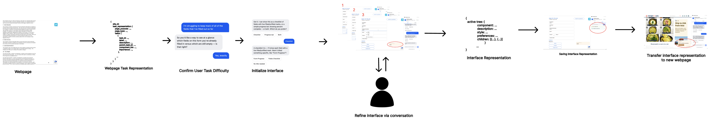
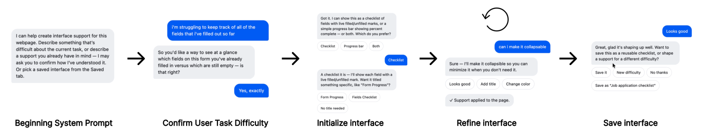
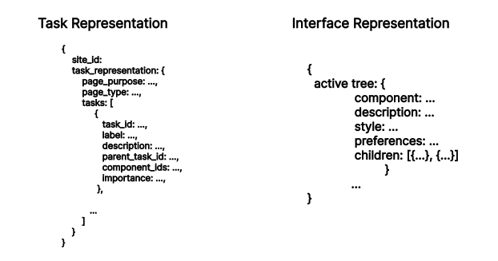
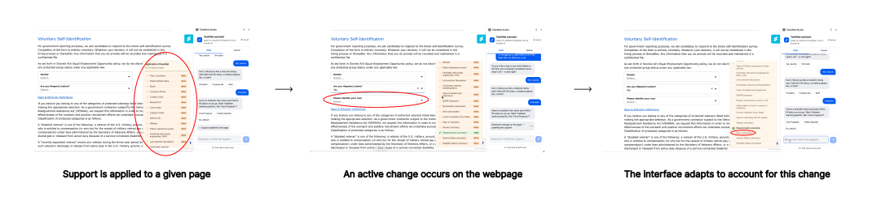
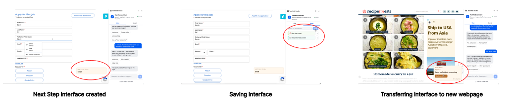
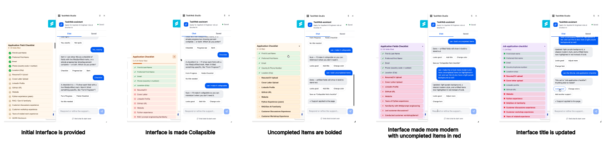
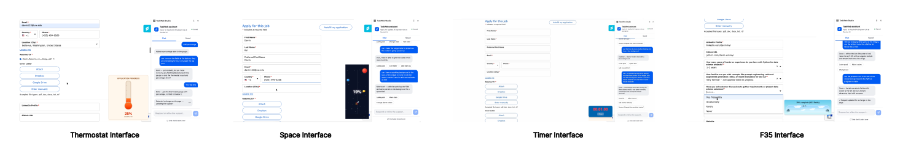

# PageAssist Studio

PageAssist lets you build support for a confusing webpage just by chatting about it. You describe
what you're struggling with on a page, and PageAssist helps you turn that into a reusable support
concept — then builds it into a small widget grounded in that page's real elements. Could be a live
checklist, a progress tracker, a "what's left" panel — whatever you and the assistant land on
together.

## In practice

Here's a visual walkthrough of the whole system: the pipeline, the conversation that drives it, and
what the result actually looks like on real pages. (Images live in `docs/assets/`.) The file-by-file
details are further down.

### System overview



You give PageAssist a webpage, and it turns that page into a task representation. From there,
PageAssist combines that representation with your preferences to build the webpage interface — the
actual support you see. Along the way it also saves an interface representation, so the same support
concept can be reused on other webpages later, not just this one.

- The **content script** reads the page, watches it for changes, and hosts the widget in an iframe.
  It doesn't draw any UI of its own — the widget draws its own title bar, drag handle, and close
  button, and just asks the host to act for it through a tiny `window.pageassist` API.
- The widget only ever shows up after you explicitly turn on a saved interface or agree to one in
  chat — it never appears uninvited. After that, if the page structurally changes (a form field
  appears, a wizard advances a step), the widget regenerates and updates itself in place.
- Completion state — like a checklist ticking off as you fill in fields — is read straight from the
  page's DOM by the content script. The model never has to compute or guess it.

### The conversation



You start with a quick introduction to the system, then describe the difficulty you're having. The
system does its best to understand it and offers you some options, or you can author your own
interface from scratch. From there you can keep refining it in chat and save it once it feels done.

### Task representation vs. interface representation



The task representation is the best model of the current page and the elements tied to that task. The
interface representation is the best model of the support you want, *without* being tied to any one
webpage — and that's exactly what makes it reusable and able to keep up with changes on the page (see
the two examples below).

### Actively adapting to webpage changes



Say support is already applied to a page, and something on the page changes — here, answering "Are
you Hispanic/Latino?" reveals a follow-up race/ethnicity question. The interface adapts to that change
on its own. You don't have to redo anything, and the page doesn't need a full re-analysis.

### Transferring a task interface to a new page



An interface built for one page (a job application) gets saved as a reusable interface
representation. Because that representation was never tied to the job page's specific fields, the
same concept can carry over to a completely different page — here, a recipe site — with a widget
grounded in *that* page's own elements instead.

### Non-predefined authoring



There's no fixed widget template to pick from. The same starting checklist gets reshaped entirely
through conversation here — made collapsible, given bold styling for uncompleted items, restyled with
a modern red accent, and retitled. Each change is genuinely new generated code, not a toggle on some
preset.

### Further authored interface examples



A few more examples of what people have authored beyond checklists: a thermostat-style completion
gauge, a "spaceship" progress visualization, a countdown timer, and a dense multi-field tracker — each
grounded in a different real page, none pulled from a predefined library.

## Folders, at a glance

| Folder | Purpose | README |
|---|---|---|
| `plugin/` | The Chrome extension you actually install — WXT + React. Reads the page, chats with the backend, and hosts the generated widget on the page in a sandboxed iframe. | [plugin/PageAssist_plugin.md](plugin/PageAssist_plugin.md) |
| `backend/` | FastAPI + Claude service. Turns a page's real elements plus your chat-shaped preferences into the concrete widget the plugin shows. `api/` = `endpoints/<domain>/` (routes) + `state/` (in-process data) + `utils/` (shared infra); `definitions/<domain>/` = `prompts.py` + `schema.py` (what the model is told, no behavior). | [backend/PageAssist_backend.md](backend/PageAssist_backend.md) |
| `tests/` | All tests for both halves, run as plain scripts (no pytest/vitest) against the real production code. | [tests/PageAssist_Tests.md](tests/PageAssist_Tests.md) |

Each of those has its own README with the full file-by-file breakdown. This one stays at the system
level: what the three representations are, and how a request flows end to end.

## The three representations

Everything in the system boils down to one of three linked representations:

- **Task representation** — a task-aware model of **one specific webpage**, grounded strictly in its
  real, visible elements. Two flat tiers:
  `{page_purpose, page_type, tasks[], components[], modeling_notes}`.
  `tasks` are coarse goals (hierarchy via `parent_task_id`); `components` are per-question, so **each
  individual form field is its own component** — that's what completion tracking targets — with
  selectors copied straight from the DOM. It's rebuilt for every page and never made up.

- **Interface representation** — a single, **webpage-agnostic** set of support preferences, shaped
  entirely through chat against a generic preview. Shape:
  `{component, description, style, preferences, children[]}`, where `style` is real CSS, `preferences`
  are short intent phrases (never literal page text), `description` is one plain sentence on what the
  support is, and `children` are structural groupings generic to the *kind* of task. Only one is
  "active" at a time, but any of them can be saved to a reusable database and re-activated on a
  different site later.

- **Webpage interface** — the concrete widget for one site: its task representation realized through
  the active interface representation. It's model-generated JavaScript that runs in a sandboxed
  iframe, plus a small host-managed `style` (frame position/size) and `state.items` (the real elements
  it's tracking).

## Design commitments

- **User authorship, not a fixed toolkit.** The widget is generated code, not a template. There's no
  predefined component library and no host-drawn UI furniture — anything you see in the widget, the
  model authored, inside the sandbox.
- **Grounded, never made up.** Task elements and widget items are copied verbatim from the real DOM.
  The model is told to flatten or show less rather than guess at structure that isn't there.
- **Cost control.** Passive page-change events have to pass a structural-change check, an agreement
  check, and a hard per-window cooldown before they're allowed to trigger a paid regeneration.
- **Isolation.** Model-generated code only ever runs in an `allow-scripts` (opaque-origin) iframe with
  `fetch`/`XHR`/`WebSocket`/`window.open` stripped out — it's structurally unable to touch the real
  page.

## Getting started

See the per-part READMEs for full instructions. Short version:

```sh
# backend
cd backend && python3 -m venv .venv && source .venv/bin/activate
pip install -r requirements.txt && uvicorn main:app --reload --port 8000

# plugin (separate terminal)
cd plugin && npm install && npm run dev
```

`npm run dev` opens a Chrome instance with the extension loaded — click its toolbar icon for the side
panel. If you haven't set `ANTHROPIC_API_KEY` / `ANTHROPIC_MODEL` in `backend/.env`, every endpoint
just falls back to a deterministic non-AI response, so the app still runs.
