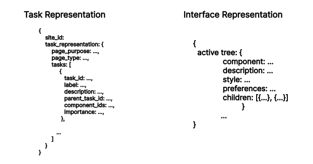
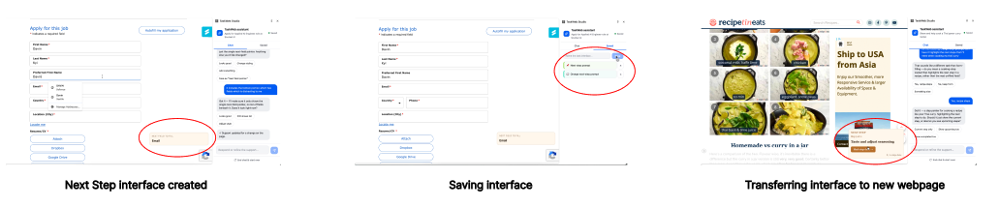
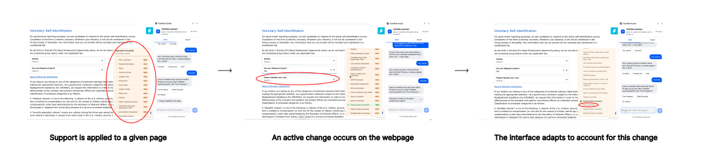

# PageAssist backend

FastAPI service that turns pages and preferences into concrete widgets via Claude. See the
[top-level README](../README.md) for what the three representations are and how the whole system fits
together. Tests live at [`../tests/backend/`](../tests/PageAssist_Tests.md).

## Run it

```sh
cd backend
python3 -m venv .venv
source .venv/bin/activate
pip install -r requirements.txt
uvicorn main:app --reload --port 8000
```

`.env` (next to `main.py`, git-ignored):

```
ANTHROPIC_API_KEY=sk-ant-...
ANTHROPIC_MODEL=claude-...
ANTHROPIC_MODEL_FAST=claude-haiku-4-5   # optional — used by /task-representations/{id}/patch;
                                        # falls back to ANTHROPIC_MODEL when unset
```

PageAssist only works with a model. Without a key + model name, or when a call fails, the route
returns an error (HTTP 502 with the reason in `detail`) and the panel shows it to the user. There are
no model-free fallbacks; see "When a model call fails" below.

CORS is open to `http://localhost:5173` (the WXT dev origin).

## How it works

A visual look at the three representations this backend produces, and the two behaviors they enable
(reuse across pages, live adaptation to page changes). The file-by-file details follow below.



The task representation best represents the current task and the elements related to that task. The
interface representation is the best representation of the desired task-based interface *without*
being grounded in any given webpage — which is exactly what makes it reusable and adaptable to active
webpage changes.



An interface built for a job application is saved as a reusable interface representation, then
re-activated on a recipe site — the widget it produces there is grounded in *that* page's own
elements, even though the underlying preferences never changed.



Support is applied to a page; an active change occurs on it (here, answering "Are you
Hispanic/Latino?" reveals a follow-up race/ethnicity question); the interface adapts to account for
the change — without the user redoing anything, and without a full re-analysis of the page. See
`/task-representations/{id}/patch` under Model calls below for the mechanism behind that adaptation.

## Folders, at a glance

| Folder | Purpose |
|---|---|
| `api/endpoints/` | The FastAPI routes — one package per domain (`task`, `patch`, `chat`, `interface_representation`, `webpage_interface`). In each, `router.py` holds only the routes and `helpers.py` the logic behind them. This is the only layer that knows about HTTP (request/response shapes, status codes). |
| `api/state/` | In-process state — plain module-level dicts that get mutated in place, plus the getters/setters around them. This is "what the backend currently believes about the world" (the current page's task representation, the working + saved interface representations, the last-generated widget). Deliberately **not** called `data/` — that name collided with `backend/data/` (the runtime JSON files below), which is a different thing. |
| `api/utils/` | Shared infrastructure with no domain knowledge: JSON file persistence, and the model clients + structured-tool-call helper. |
| `definitions/` | The prompt text and Pydantic/JSON-schema definitions for each domain — pure data, no behavior. This is where you go to change what the model is told or what shape it must answer in. |
| `data/` | Runtime JSON files (git-ignored) — the on-disk form of `api/state/`'s in-memory dicts, so state survives a server restart. **Not** the `api/state/` package — same word, different folder, see above. |

Three layers under `api/`: **endpoints** (HTTP surface), **state** (in-process data), **utils**
(infra with no domain knowledge). Each `api/endpoints/<domain>/` and `definitions/<domain>/`
re-exports from its `__init__.py`, so callers write `from api.endpoints import task` and
`from definitions.task import TASK_REPRESENTATION_GUIDE, ...`.

## Layout — what each file is

```
backend/
  main.py            FastAPI app: mounts the 5 routers, turns a ModelError into a 502, /health
  api/
    endpoints/        one package per domain (each __init__ re-exports `router`)
    state/             in-process state (mutated in place, never rebound — see Folders above)
    utils/             shared infra used across domains
  definitions/        prompts + schemas per domain — NO behavior. one prompts.py + schema.py each
  data/                runtime JSON (git-ignored) — NOT the api/state/ package
```

**`api/endpoints/`** — one package per domain, each `__init__.py` re-exporting `router`:

| File | Purpose |
|---|---|
| `task/router.py` | `POST /task-representations/{id}/analyze` and the `GET` |
| `task/helpers.py` | the analyze model call |
| `patch/router.py` | `POST /task-representations/{id}/patch` |
| `patch/helpers.py` | removing and appending components, the revealed-question rule, the fast patch model call |
| `chat/router.py` | `POST /chat` |
| `chat/helpers.py` | the chat model call, `tree_has_content`, `prune_empty_parts` (drops parts with nothing in them before the tree is stored) |
| `chat/repair.py` | the tree-repair call, run when a chat turn says it changed the tree but returned none |
| `interface_representation/router.py` | `/interface-representation(s)` — working tree + saved DB CRUD |
| `webpage_interface/router.py` | generate/GET a widget |
| `webpage_interface/helpers.py` | the widget model call, `enforce_bundled_selectors`, `components_to_items`, the failure widget |
| `webpage_interface/failed_widget.js` | the red warning widget shown in place of the widget when generation fails |
| `records/router.py` | `POST /records/screenshots`, `/records/errors`, `/records/events`: what the side panel sends to the study records |

**`api/state/`** — plain module-level dicts + the getters/setters around them:

| File | Purpose |
|---|---|
| `task.py` | `task_store` (the single current-webpage slot) + persistence |
| `interface_representation.py` | `interface_store` + active-tree accessors + persistence + default tree |
| `webpage_interface.py` | the current widget — IN MEMORY ONLY (never persisted) |

**`api/utils/`** — shared infra with no domain knowledge:

| File | Purpose |
|---|---|
| `json_store.py` | shared JSON load/dump + points at `backend/data/` |
| `llm.py` | provider switch (Anthropic or Gemini), `create_message()` (→ `anthropic_create_message` / `gemini_create_message`), `call_structured_tool()`, `THINKING_LEVELS`, `ModelError` |
| `records.py` | the study records: a folder per chat session in `user_study/` at the top of the repo (see Study records below) |

**`definitions/`** — one `prompts.py` + `schema.py` per domain, pure data:

| File | Purpose |
|---|---|
| `task/prompts.py` | `TASK_REPRESENTATION_GUIDE` — how to read a page into its tasks hierarchy, the components within it, and their relationships; plus the element, component and requirement blocks the patch prompt shares |
| `task/schema.py` | the task representation's Pydantic models + tool `input_schema` |
| `patch/prompts.py` | `PATCH_TASK_REPRESENTATION_GUIDE` — how to model just a few new elements |
| `patch/schema.py` | `TaskPatchRequest`, `PatchOut`, the `add_components` tool |
| `chat/prompts.py` | `PAGEASSIST_GUIDE` — how to hold the conversation, when to set `agreed`; ends with the interface representation's rules |
| `chat/schema.py` | `Chat*` models + the `reply_and_update_preferences` tool |
| `repair/prompts.py` | `INTERFACE_TREE_REPAIR_GUIDE` — the tree-repair call's prompt |
| `repair/schema.py` | the `build_interface_representation` tool |
| `interface_representation/prompts.py` | `INTERFACE_REPRESENTATION_RULES` — the tree's rules, shared by `PAGEASSIST_GUIDE` and the tree-repair prompt |
| `interface_representation/schema.py` | `TREE_SCHEMA` (the tree's JSON schema, used by the chat and repair tools so every part has fields to fill) and `SaveInterfaceRepresentationRequest` |
| `webpage_interface/prompts.py` | `WEBPAGE_INTERFACE_GUIDE` — how to turn the interface representation + page into a widget |
| `webpage_interface/schema.py` | the `build_webpage_interface` tool's `input_schema` |
| `records/schema.py` | the bodies of the records routes: a screenshot, an error, an event |

**`data/`** — runtime JSON (git-ignored), the on-disk form of `api/state/`'s dicts:

| File | Purpose |
|---|---|
| `task_representations.json` | `{site_id, task_representation, page_text}` |
| `interface_representations.json` | `{active_tree, active_agreed, representations{}}` |
| `records/` | the study records, a folder per chat session (see Study records below) |

Imports: state lives in `api/state/<domain>.py`, mutated in place (never rebound), so
`from api.state.task import task_store` stays valid after `replace_task_store()`. `chat` and
`webpage_interface` endpoints read the active tree from `api.state.interface_representation`;
`webpage_interface` also reads the task representation from `api.state.task`. Note `api/state/`
(Python package, in-process state modules) is distinct from `backend/data/` (runtime JSON files,
resolved by `json_store.py`) — same word "data" doesn't appear in the package name precisely to avoid
that confusion.

## Endpoints

| Method + path | Purpose |
|---|---|
| `GET /health` | liveness |
| `POST /task-representations/{site_id}/analyze` | Build this page's **task representation** from its real elements; replaces the single stored slot. Body may include `page_text` (the page's readable prose), stored for widget generation. This is the expensive, full-model call — used on first load of a page and whenever the page has changed enough that a partial patch wouldn't be trustworthy. |
| `POST /task-representations/{site_id}/patch` | Fast path — splice just-added fields in / drop removed ones (the fast model) instead of re-modelling the whole page. Returns the full updated representation plus `changed: bool` (false when the flagged DOM change turned out cosmetic — nothing was actually added/removed, so the caller shouldn't bother regenerating the widget) and `added_items` (the new components as widget items, which the panel splices into the widget already on the page instead of regenerating it). |
| `GET /task-representations/{site_id}` | Read the stored task representation (404 if it's for another site). |
| `GET /interface-representation` | The active **interface representation** (the working preference tree) + its `agreed` flag. |
| `POST /interface-representation/reset` | Blank the active tree and clear `agreed` — this is what "new chat" / "end chat and start over" calls. |
| `GET /interface-representations` | List saved, reusable interface-representation entries (`{id, name}`) — the "Saved" tab's data. |
| `POST /interface-representations` | Save the active tree as a new named entry in that reusable database: `{name, record_id?}`, where `record_id` is the interface showing, which the study records file the save with. |
| `POST /interface-representations/{id}/activate` | Copy a saved entry into the active tree (this counts as agreement — the widget can be generated from it immediately). |
| `POST /interface-representations/{id}/update` | Write the current active tree back onto that saved entry (overwrite it with whatever chat has since refined). An optional `{record_id}` body files the update with the interface showing. |
| `DELETE /interface-representations/{id}` | Remove a saved entry. The working tree is untouched — if it came from this entry, it's just unlinked (no more "update the one I came from" offer). |
| `POST /chat` | One conversational turn. May reply with text only, or also replace the active interface representation and/or flip `agreed` to true (the model's "this concept is concrete enough to show" signal). |
| `POST /webpage-interfaces/{site_id}/generate?reason=` | Combine the stored task representation + the active interface representation into a **webpage interface** (a concrete, model-generated widget); hold it in memory and return it. This is the call that actually produces the thing that shows up on the page. `reason` (`chat`, `saved` or `page-change`) says why it was built, and the widget comes back with the `record_id` it's filed under in the study records. |
| `POST /records/screenshots` | A screenshot of an interface, `{record_id, reason, image}` as a PNG or JPEG data URL, filed with it in the records. `reason` is `applied`, `updated`, `saved` or `final`; each gets its own numbered file, except `final`, which is replaced. Refused for an interface that isn't in the current session. |
| `POST /records/errors` | An error the side panel showed, or one from the widget's code: `{source, where, message}`. |
| `POST /records/events` | Something else worth keeping, such as how a page change was applied to the interface: `{kind, details}`. |
| `GET /webpage-interfaces/{site_id}` | Read the in-memory widget (404 after a restart, or for another site — nothing is regenerated automatically). |

`site_id` is an opaque key the client builds from `hostname + pathname + search` (with `/` → `~`) and
`encodeURIComponent`s into the path. Store the raw value; match on it exactly.

## Study records

For user studies, the backend keeps everything PageAssist makes in `user_study/` at the top of the
repo, outside `backend/` so it's easy to find. It's never committed, and `PAGEASSIST_RECORDS=off` turns
it off. A throwaway `PAGEASSIST_DATA_DIR`, as the tests use, takes the records with it, so a test never
adds to the study. Each chat session gets its own folder, named by when it started. A session starts
when the side panel opens or the user starts over.

```
user_study/2026-10-20_14-03-11/
  summary.json                    counts and timings for the session, updated as it goes
  conversation.jsonl              one line per chat turn: what the user said, the reply, the quick
                                  replies, whether they had agreed, and the interface version it made
  interface_representations/      every version of the interface representation: 001.json, 002.json ...
                                  each with the chat turn or saved interface it came from
  task_representations/           every analysis and page-change patch: 001-analyze-<page>.json ...
  interfaces/001-<page>/          every interface built for a page
    code.js                       the widget's code
    widget.json                   its style and items
    interface_representation.json the interface representation it was built from
    task_representation.json      the task representation it was built from, so each interface is
                                  complete even in a session that started over without a new analysis
    meta.json                     why it was built, how long it took, its items, the iterations
                                  that led to it, and the names it was saved as
    screenshot-applied.png        the widget when it appeared, taken by the side panel
    screenshot-updated.png        the widget after a page change was spliced into it
    screenshot-saved.png          the widget when it was saved, or a saved one was updated
    screenshot-final.png          the widget as it was last seen: retaken a few seconds after its
                                  checkmarks change, and just before it's replaced or the user starts over
  errors.jsonl                    errors from the backend, the side panel and the widget's code
  events.jsonl                    interfaces saved, updated or deleted (a save names the interface that
                                  was showing), and how page changes were applied
```

`summary.json` counts the iterations: `chat_turns`, `turns_to_agreement` (the turn on which the user
agreed to an interface; 0 when they used a saved one), `interface_representation_versions`,
`refinements_after_agreement` (changes made after agreeing), and interfaces built by reason. Each
interface's `meta.json` has the same counts as of when it was built.

What is left out, to keep participants' data out of the records:
- The page's text and anything typed into the page. Task representations are kept, the page text
  used to build widgets is not.
- Page addresses keep no query string, and errors are filed by route rather than by page address.
- Screenshots are cut down to the widget, so nothing else on the page is kept.

The conversation is kept as written, so it can include what participants say about themselves.
Cover it in the consent form, and keep the folder somewhere secure.

## The three representations — what each one is for

PageAssist's whole pipeline is three progressively more concrete objects, each built from the one before
it (see the [top-level README](../README.md) for the end-to-end picture; this section is what each one
*is* and why it exists as its own thing rather than being folded into another; see How it works above
for the shapes of the first two side by side).

- **Task representation** (`definitions/task/`, `api/state/task.py`) — a structured model of what a
  *specific page* is asking the user to do, grounded in its real DOM elements. Two tiers: `tasks` are
  coarse goals ("fill out this application"), `components` are individual, per-question groupings (one
  form field, or a genuine multi-part answer like a split address) each carrying real CSS selectors
  (`dom_selector` / `member_selectors`) copied verbatim from the page. It exists so that everything
  downstream — the chat, the widget — can talk about "this page's fields" without re-parsing the DOM
  itself, and so the model never has to assert whether a field is filled (the client reads that live).
  One page's worth lives in the store at a time; a new `site_id` replaces it.
- **Interface representation** (`definitions/interface_representation/` for its rules, built by
  `definitions/chat/`'s conversation; `api/state/interface_representation.py`) — the
  user's *page-agnostic* preferences for what kind of support they want and how it should behave (a
  short tree: `component` slug, human-readable `description`, `style`, `preferences` phrases,
  `children` for structural grouping). This is deliberately **not** grounded in any one page's
  elements — it's the reusable "shape" of the support (e.g. "a checklist, docked bottom-right, one
  item per required field") that the same user might want realized on many different sites. `/chat`
  builds and refines it; the "Saved" tab lets a finished one be reused without re-explaining it. It has
  a working copy (the one chat is currently shaping) and a saved database of named ones.
- **Webpage interface** (`definitions/webpage_interface/`, `api/state/webpage_interface.py`) — the
  concrete result of realizing one interface representation against one page's task representation:
  actual generated JavaScript (`code`) plus its initial `state`, meant to run in the sandboxed widget
  iframe on that specific page. This is the only one of the three that's actually shown to the user,
  and the only one never persisted to disk — it's cheap to regenerate from the other two and only
  meaningful while the client that asked for it is still on that page.

Because the interface representation is never grounded in any one page, the same one can be built for
one site and reused on a completely different one (see the transfer example under How it works above).

## State

- **`data/task_representations.json`** — `{site_id, task_representation, page_text}` (`page_text` = the
  page's readable prose, kept for widget generation). One page at a time;
  analyzing a new `site_id` replaces the whole thing.
- **`data/interface_representations.json`** — `{active_tree, active_agreed, representations{}}`. The
  tree is `{component, description, style, preferences, children}`. `active_agreed` is a one-way latch
  (only `/chat` on real agreement, or activating a saved entry, sets it true; only reset clears it)
  and gates whether support may ever show on a real page.
- **The generated widget is not persisted** — it lives in `api/state/webpage_interface.py` as a
  module global and is gone on restart. It's cheap to regenerate and only meaningful while the client
  that asked for it is still on the page.

## Model calls

All three go through `api/utils/llm.py` → `create_message()`, which uses the **streaming** API
(`messages.stream`) — mandatory once `max_tokens` is large (the SDK hard-errors on big non-streaming
requests). `max_tokens` is 32000 for all three.

On Gemini, each call takes its thinking level from `THINKING_LEVELS` in `llm.py` (the Anthropic
branch ignores it): `"low"` for chat and `/patch`, `"medium"` for the task representation and the
widget. A higher level is used only when it costs little extra time, and no step up does. Seconds
per call over 3 runs (averages; the Greenhouse rows are medians from an earlier measurement):

| Call | low | medium | high |
|---|---|---|---|
| chat reply | 2.0 | 3.1 | 6.3 |
| chat turn that builds the tree | 4.7 | 13.5 | 29.1 |
| page-change patch | 1.9 | 11.1 | 24.2 |
| task representation (Greenhouse form) | 28 | 52 | 293 (past the panel's 240s timeout) |
| widget (Greenhouse form) | 20 | 71 | 156 |

Chat replies are about as fast at medium, but its turns that build the tree take 3 times as long, so
chat at medium is over twice as slow on average.

`call_structured_tool()` is the shared pattern for the structured calls:

1. Force a single tool with `tool_choice` — the model structurally cannot return prose or skip a
   required field.
2. Validate the tool input against a Pydantic model (raises on a bad enum, missing field, wrong shape).
3. On a validation failure, feed the **exact error** back as an `is_error` tool_result and let the
   model correct itself (up to 2 retries).
4. No result, a failed call, or still invalid after retries → raise `ModelError`, which `main.py` returns as a 502.

Used by `analyze` (validates against `TaskRepresentationOut`) and `/chat` (`ChatDecision`).
`webpage-interfaces/generate` uses forced tool-use without the retry loop (a failure raises `ModelError` too, and the route answers with the warning widget below) (its output is executable
code, not a closed schema); its user message is a labelled block (the interface representation, the
task representation, and — when stored — the page's `page_text`). The guide has the model pick the
task(s) the interface representation serves and build from their components; a page's own steps are
reproduced in full unless the interface representation says otherwise. Widget `state.items` may be **grounded** — a single
`selector`, or `selectors: [...]` when the item tracks a question answered by more than one control
(first + last name, a split address); the host requires ALL listed selectors filled before the item
counts complete, since one selector can only ever reflect one part of a multi-control answer — and
host tracks `complete` from the DOM either way — or **manual** (`manual: true`, no selector/selectors;
a recipe step / a section — the widget owns its checked state, the host never touches it). The host
also sets `required` on every grounded item from the page itself (a `required` attribute,
`aria-required`, or an asterisk in the question's label), so the model never guesses it; an optional
`section` key is the model's own grouping, passed through untouched — the guide tells it to set any
key its code groups by on every item. An optional `detail` carries fuller text copied from the page
(the whole instruction: what to do, where to click, what the user will see), shown under the label;
the guide requires it when the interface representation asks for detail or a walkthrough, and when a
page's steps are made one item each, every instruction under a step goes in that item's `detail`.

Because this call has no validation-retry loop, the model isn't always trusted to pick `selectors`
correctly on its own — `build_webpage_interface` runs `enforce_bundled_selectors()` over the returned
`state.items` afterward, which re-derives each component's real bundling straight from the task
representation's `member_selectors` and upgrades any item naming only ONE member of a bundle (via
`selector`, or an under-filled `selectors`) to the full member list. This makes it irrelevant which
single control the model happened to ground on — e.g. a phone number's country-code picker vs. the
number itself — since the item ends up requiring every member either way. (There's no reliable way to
tell in advance which member is a genuinely pre-filled default; a country-code picker isn't guaranteed
to start with one — Greenhouse's own phone widget ships it blank — so the safer rule is to just require
all of them.)

`member_selectors` is "the key nodes in this component" (see `definitions/task/schema.py`), NOT
"the controls that must each be filled" — it routinely also carries the component's own `<label>`
(a near-universal `aria-labelledby` pattern gives the label its own id, e.g. `#first_name-label`
beside `#first_name`) plus description/error/help text nodes. `looks_control_like()` (used by both
`enforce_bundled_selectors` and `components_to_items`) excludes an id containing
`label`/`legend`/`description`/`error`/`hint`/`help`/`message`/`caption` before counting what's left
as a real control — otherwise a plain single-field component's own label id reads as a second
"required" control that, being a `<label>`, can never complete, and the item locks incomplete forever
no matter what the user types. (This is exactly what happened before this exclusion existed: adding
`enforce_bundled_selectors` broke live completion for ordinary text fields site-wide.)

This is the mechanism behind the adapting-to-changes example under How it works above:

`/task-representations/{id}/patch` uses `get_fast_client_and_model()` (`ANTHROPIC_MODEL_FAST`, else
`ANTHROPIC_MODEL`; on Gemini, low thinking — about 2s, and it added a revealed question correctly every
time at every level) with a tiny prompt that returns **only the new component(s)** for a few
just-appeared elements (told to return an empty list when they aren't task-relevant); the route
splices them in (and drops components for removed selectors), re-ids to avoid collisions, and links
them to the first top-level task, the page's main one. `remove_components` reports how many EXISTING components it actually dropped — a UI-only DOM swap
inside an already-modelled question (a file-upload button row replaced by a "&lt;filename&gt; ×"
chip) almost never matches a real component's selector, so `changed` comes back `false` and the panel
skips regenerating the widget instead of claiming an update happened for nothing. `revealed` carries
questions that were in the DOM but hidden and have come into view, grouped per question: a group
with any control already mapped by a component is an availability change and adds nothing (so one
unmapped option of a mapped radio group can't become a lone component); only fully unmapped groups
join `added`. `containers` gives the patch prompt the same structural context the full analyze had.
The response's `added_items` (`components_to_items` over just the new components) lets the panel
splice the change into the widget already on the page — a page change that only adds or removes a
question then takes seconds instead of a full widget regeneration (~70s at medium thinking).

### Task representation specifics

- **Flat lists, linked by id, no count cap.** `tasks` are coarse goals (hierarchy via
  `parent_task_id`); `components` are semantic groupings; `relationships` link components. There is
  no page type: a page isn't fixed to one kind. `task_type` is a **free string** (short kebab-case). A
  component's `label` is what the element does or asks for, in a few words; its `description` is
  what else the user needs to know, from the page, and is required: for a question, how it's
  answered (its options, format, limits, help text); for a step, the full instruction; for an action,
  what using it does; for content, a heading, a status or media, what it says or shows. It's `""`
  only when the page gives nothing beyond the label. Nothing about the user's task is asserted ahead of time,
  so there is no `required_for_task` or `importance` (the host reads `required` from the page itself).
  Closed `Literal`s: `component_type` (what kind of thing it is, for widget generation: `text-` /
  `long-text-` / `single-choice-` / `multi-choice-` / `toggle-` / `date-` / `file-question`,
  `other-question` for any other kind of question, `step`, `content`, `heading`, `action`,
  `navigation`, `status`, `media`, and `other` for anything else) and the relationship `type` (`depends_on`: a follow-up that
  applies only given another answer; `precedes`: the page's own order; `alternative_to`: either one
  satisfies the need). Relationships need visible evidence; ones pointing at a missing component,
  a self-link or a duplicate are dropped on validation, and removing a component drops its links.
- **The form-question rule** (from the prompt): every individual form question is its **own**
  component — never bundled with adjacent questions — because per-field completion tracking targets
  components individually. Controls combine only when they answer one question together under one
  label, so that no part answers it alone (a date's month + year under "Start date", a phone number's
  country-code picker + number under "Phone"). The prompt states the rule without examples. When a
  component's `member_selectors` do bundle more than one control this way, `enforce_bundled_selectors`
  makes that question's widget item `selectors: [...]` (see above) — otherwise the checklist would
  read the whole question done the moment just one part was filled.
- **Dynamic UI** (from the prompt): what only appears while a control is in use — an open dropdown's
  options, a date picker's calendar, suggestions, a tooltip, a validation message, an upload's file
  chip — belongs to that control's component, never a component of its own.
- **Prompts.** `TASK_REPRESENTATION_GUIDE` (analyze) and `PATCH_TASK_REPRESENTATION_GUIDE` share the
  same element, component, relationship and requirement blocks, so a patched component is shaped
  exactly like an analyzed one; the analyze guide ends with a placeholder skeleton of the output (no
  real values, so nothing to copy). The patch
  is validated against the same component model (`PatchOut`) and may link a new component to an
  existing one — a revealed follow-up `depends_on` the question that revealed it. If the model returns
  no components (the new elements aren't task-relevant), nothing is added.
- **Grounding.** Every `dom_selector` / `member_selector` is copied verbatim from an input node;
  prefer `visible` nodes; never assert a value, completion, or "required" without a visible marker.
  Completion is read live by the content script — there are no model-asserted status fields.
- **Input pruning** is client-side: content.ts collects controls, labels, headings, prose, table
  cells, images and role-bearing nodes, priority-sorts (controls, labels/legends, headings first;
  visible before hidden) and sends the top ≤500 as `{id, selector, tag, text, role, accessibleName,
  description, completion_status, container, visible}` plus a `containers` list (`{selector, tag, role,
  label, parent}`) — each element's `container` points into it. `completion_status` is input context
  only (as of the scan); the model never outputs completion. `analyze` re-caps at 500. The panel does
  extra forced re-analyzes when a form-heavy page comes back with suspiciously few components (still
  hydrating).

### When a model call fails

There are no model-free fallbacks: PageAssist only works with a model, and tells the user right away
when one isn't available.

- `analyze`, `/patch` and `/chat` raise `ModelError`; `main.py` returns it as HTTP 502 with the
  reason in `detail`, and the panel shows that reason (a chat turn says it couldn't get a reply; an
  analysis says it couldn't analyze the page).
- `generate` returns a red warning widget (`failed_widget.js`, `degraded: true`) in place of the
  widget, with the error and a hint to try again; the panel also says generation failed.
- The tree-repair call raising, or returning no tree, fails the chat turn the same way.
