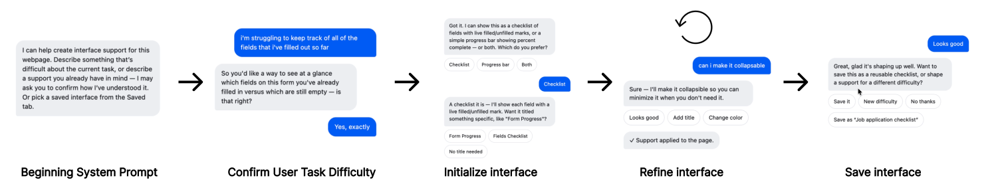
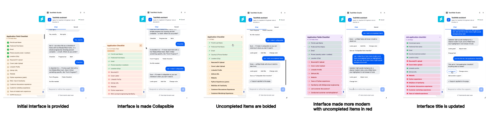
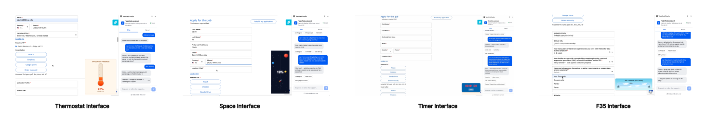

# PageAssist plugin

Chrome MV3 extension built with [WXT](https://wxt.dev) (Vite + React). See the
[top-level README](../README.md) for the system overview and the three representations.

## Run it

```sh
cd plugin
npm install
npm run dev
```

`npm run dev` launches a dedicated Chrome instance with the extension loaded and hot-reloading across
the side panel, content script, and background worker. Click the toolbar icon to open the side panel.

One-off production build: `npm run build` (runs `tsc --noEmit` then `wxt build`) → output in
`.output/chrome-mv3/`. Load it via the browser's extensions page → Developer mode → "Load unpacked".

Set `VITE_API_URL` if the backend is not at `http://localhost:8000`.

## How it works

The conversation the side panel drives, and what the sandbox is capable of rendering. The file-by-file
details follow below.



The chat this component drives, end to end: the user is given an introduction, voices their task
difficulty, is offered options or authors their own interface, refines it, and saves it once complete
— each step above is a real transcript from that flow.



There is no fixed widget template running in the sandbox — the same starting checklist can be
reshaped entirely through conversation, each time as genuinely new generated code rather than a
toggle on a preset.



And because nothing about the sandbox is checklist-specific, users have authored widgets well outside
that shape too — a completion gauge, a progress visualization, a countdown timer, a dense multi-field
tracker.

## Folders, at a glance

| Folder | Purpose |
|---|---|
| `entrypoints/` | The four separate JS contexts Chrome actually runs: the background service worker, the side panel (React UI), the content script (runs on every real page), and the widget sandbox (runs model-generated code in isolation). WXT wires each of these up as its own bundle from this folder's structure. |
| `lib/` | Pure, framework-free helper modules shared across entrypoints — DOM reading, selector computation, completion detection, mutation analysis. Kept separate from `entrypoints/` specifically so they can be unit-tested directly (see [`../tests/plugin/`](../tests/PageAssist_Tests.md)) without needing a browser or the WXT build. |

## Entrypoints — what each file is

| File | Context | Role |
|---|---|---|
| `entrypoints/background.ts` | service worker | One line: open the side panel on toolbar click. |
| `entrypoints/sidepanel/App.tsx` | extension page (React) | The orchestrator — see below. |
| `entrypoints/content.ts` | every web page | The page-side agent — see below. |
| `entrypoints/sandbox/main.ts` | `allow-scripts` iframe | Runs the model-generated widget code in isolation — see below. |

## `lib/` — what each file is

| File | Purpose |
|---|---|
| `completion.ts` | The core "is this element/item actually filled or chosen?" logic — `isElementComplete` (one control, with wrapper/react-select/radio-group handling) and `isItemComplete` (a widget item's `selectors: [...]`, requiring every one). Answered means: non-empty text (never just spaces), a checked checkbox, any option of a radio group, a chosen file, a dropdown option with a non-empty value, or a supported custom selection state. A wrapper is decided by its own answer — its choices, else its own answer field, else the value a custom dropdown shows — never by a neighbouring filled control, and never while every option is unchecked. A pre-filled field counts once changed to a value that is itself an answer, or once the user has visited it (focused it, then moved on) and left a real default in place — an untouched default never counts; a checkbox/switch/toggle is read from its state, never from having been clicked; "None" / "N/A" are answers, not placeholders. Only elements whose state changes when answered are tracked. `isActionElement` marks actions (buttons, links, `summary`, tabs, and submit/button/reset/image inputs, whose `value` is never read as an answer), and they are never complete; a button with a state (`aria-pressed`, `aria-checked`, a dropdown trigger showing its choice, a chosen class) is not an action. Beyond native fields it handles custom sliders and spin buttons (`aria-valuenow`, judged against their starting value like a native number), custom textboxes (`role="textbox"`/`"searchbox"`, ignoring their own placeholder text), standalone listboxes (a selected `role="option"`, but not a dropdown's option list), a checkbox in the `mixed` state, and elements that only label a question, judged by what they name (`answeringElement`): a `<label>` by its control, an element whose id a control points at with `aria-labelledby`, a `<legend>` by its fieldset, and a table row's header by its row. Pure DOM reads; no browser APIs beyond the DOM itself, so it runs the same way in a real page and in the linkedom-based tests. |
| `selectors.ts` | How a real element gets turned into a CSS selector string, an ARIA role, an accessible name, and an accessible description (help text / validation message) — one implementation so every caller (page scanning, mutation reports, widget-item grounding) agrees. Names follow the ARIA order (`aria-labelledby` before `aria-label`), links/buttons/headings are named by their own text, and names/descriptions come back in full — any length limit is the caller's. Selectors are identity-based, never positional. `stableSelector` always returns a selector that matches only that element, and nothing content.ts would find first in the page's own document: its id (when no other element shares it), an identifying attribute (`data-testid`, `name`, `aria-label`, `placeholder`, …) alone or combined with narrowing ones (`type`, `role`, … and `value` for choices and buttons only, since React rewrites a text field's `value` attribute as the user types) so radios sharing a name are told apart by value, then those or the bare tag scoped under the closest uniquely identified ancestor, and only then a `data-tw-ref` stamp. A chosen selector sticks while it still finds its element first, so adding a look-alike later (a second education entry reusing `name="school"`) doesn't change the first one's identity. |
| `page-scan.ts` | `scanPage()` walks the live DOM (into shadow roots and same-origin iframes) into what the backend analyzes: the element list, the context containers that keep their relationships, and a field snapshot keyed by *question*. Anything inside a transient layer is left out: an open dropdown, menu, tooltip, autocomplete list or calendar, matched by ARIA role, by popup-ish class names (generic ones plus the popup classes of common libraries: popper/Floating UI, Radix, Headless UI, Tippy, Select2, Chosen, Selectize, Tom Select, Choices.js, Google Places, intl-tel-input, jQuery UI, Angular Material, Ant Design, Element, Vuetify, PrimeReact, Kendo, and the common date pickers), or by being the element an open combobox or popup trigger points at with `aria-controls`/`aria-owns` (a plain disclosure button's section is not a popup). Names a field itself also uses are only matched in their popup forms: Materialize puts `select-dropdown` on the select's visible input, and layers that can also hold a dialog (Vuetify 3's `v-overlay__content`) are left out, since a dialog can hold real questions. A popup-looking class on `<html>`/`<body>`, or on a wrapper holding the page's main content, h1 or a whole form, doesn't count either: WordPress themes put `sticky-menu-fade` / `dropdown-hover` on `<body>`, which used to drop the entire page. `isElementVisible` counts as hidden: `hidden`/`inert`, no box, `display:none`, `visibility:hidden`/`collapse`, `content-visibility:hidden`, `opacity:0` (the element's own, except for a control, since styled radios hide the native input behind a custom one; or any ancestor's), and a collapsed container that clips its content (a `position: fixed` element escapes that clipping). A field no one can reach is hidden too: out of the tab order, and hidden from assistive technology or moved far off the page, like a newsletter's spam trap or a react-select's hidden validation input. One scan shares a cache, so each container's style is read once. `diffFieldSnapshots` compares two snapshots (added / revealed / removed / hidden questions). Also `getPageText()`, for widget items grounded in page prose rather than a form field. |
| `mutations.ts` | The mutation logic content.ts uses. `observeTree` watches the page, its shadow roots and its same-origin iframes (again after an iframe loads a new document); `changedOutsideInterface` drops mutations in the widget frame and the selectors' own `data-tw-ref` stamps; `mutationsIncludeFieldChange` is the MutationObserver gate (could this have added, removed, shown or hidden a question?); `buildPageChangeEvent` diffs the new scan against the last snapshot into the `PAGE_CHANGED` event; `describeMutation` turns a raw `MutationRecord` into a compact, JSON-safe summary — the stable identities (never a bare tag like `div`) of the controls added and removed, including those nested inside an added/removed wrapper, how many controls came or went, and truncated text. |
| `widget-items.ts` | Helpers for a widget's `state.items`: `itemSelectors`, `isItemRequired` (whether the page marks an item's question required — its own `required` / `aria-required` with `"false"` a clear no, a radio group's `required` option, the nearest wrapper's `aria-required`, else an asterisk or "(required)" in its label or its fieldset/group's label), and `spliceWidgetItems` (applies a page change to a widget already showing: drops controls that left, adds each new answerable question in page order with its neighbour's `section`, skips headings/buttons/anything already tracked). |
| `interface-frame.ts` | The widget's `<iframe>` on the host page (`createInterfaceFrame`): creating it, loading a fresh sandbox document into it for every new widget (`reload`), docking a frame with no position yet bottom-right at a readable size, fitting its height to the content the sandbox reports (unless pinned), and moving it on a drag. It handles the sandbox's frame requests (`dragStart`/`dragEnd`, `resize`, `setHeight`, `resetHeight`). A dragged frame keeps its place because it has a left/top position of its own, so no separate "moved" flag is kept; a position the widget asks for replaces it. This has to run on the host page: the sandbox can't move or size its own frame. |
| `frame-drag.ts` | The host side of dragging the widget's frame (`startFrameDrag`). The widget only calls `window.pageassist.startDrag(event)`; the host then moves the frame by the pointer's `screenX`/`screenY` (client coordinates shift as the frame moves), and for the drag's duration covers the page with a transparent layer — an out-of-process iframe stops receiving pointer events once the pointer leaves it, so without the layer a fast flick drops the drag. Positions from the layer and from the widget's forwarded events share one running position, so nothing is counted twice; the layer comes down on release, on cancel, or on a move with no button held. |
| `screenshot.ts` | Screenshots of the widget for the study records: `cropBox` finds the widget in a screenshot of the tab, scaled to the screen's pixel density, and `cropScreenshot` cuts it out as a PNG, so nothing else on the page is kept. |
| `frame-style.ts` | Applies host-owned CSS (position/size only) to the widget's outer `<iframe>`, with a small denylist (`url()`, `expression()`, `javascript:`, `@import`) against a widget trying to load external resources or execute code through a CSS value. |
| `api.ts` | The backend base URL and a `fetch` wrapper with a hard timeout — the Anthropic-backed endpoints have none of their own, so a hung call would otherwise leave the panel stuck forever. |
| `extension.ts` | The narrow slice of the `chrome.*` API the side panel actually uses, typed, plus `requestPageElements()` — the one-shot "ask the active tab's content script for its page elements", including the force-inject-if-missing retry. |

`lib/completion.ts`, `lib/selectors.ts`, `lib/page-scan.ts`, `lib/mutations.ts`, `lib/widget-items.ts`, `lib/frame-drag.ts` and `lib/interface-frame.ts` have node tests at
[`../tests/plugin/`](../tests/PageAssist_Tests.md) — e.g. `node tests/plugin/completion.test.ts`.

## Side panel (`sidepanel/App.tsx`)

`App.tsx` holds the state and logic; the rest is split out beside it: `ChatTab.tsx` and
`SavedTab.tsx` (the two tabs' layout), `types.ts` (the schemas shared with the backend, and the
panel's own state types), `backend.ts` (every backend call; a failed call throws with the backend's
own message, which the panel shows), `page-messages.ts` (the messages between the panel and the
content script: apply a widget, splice a page change, and `listenToPage` for page changes and
completion updates) and `helpers.ts` (site ids, the sparse-page check, merging queued page changes,
saved-entry accents, default save names).

The only UI surface in the extension, and the orchestrator — it is what decides *when* to talk to the
backend and *when* to push a widget onto the page; neither the content script nor the sandbox ever
decides that themselves (see the conversation walkthrough under How it works above). It:

- Computes a `site_id` from the active tab's URL (`hostname + pathname + search`, `/` → `~`) and, on
  a real page change, calls `POST /task-representations/{id}/analyze`. If the active tab has no content
  script (it was already open when the extension loaded), the panel force-injects it via
  `chrome.scripting.executeScript` before retrying — no page refresh needed.
- Chats with the backend (`POST /chat`) to shape the **interface representation**; manages the saved
  database (list / save / activate / delete; searchable, with a per-entry emoji + colour accent
  derived from its id).
- On explicit **activate** or **agree-in-chat**, calls `POST /webpage-interfaces/{id}/generate` and
  pushes the result to the content script. A chat turn only re-triggers this when the returned
  `interface_representation` actually differs (by value) from the tree last generated from
  (`appliedTreeJsonRef`) — `agreed` stays true across many later turns (e.g. "looks good", "save it"),
  and the model doesn't always send `null` on a turn that isn't itself an edit, so this catches an
  unchanged tree client-side rather than flashing "Applying the change to the page…" for nothing.
- Listens for `PAGE_CHANGED` messages: a *structural* one (a field element entered/left the DOM) while
  a widget is showing **patches** the task representation with just the added/removed fields
  (`POST /task-representations/{id}/patch` — fast) then splices the added/removed questions into the
  widget already on the page (`UPDATE_WIDGET_ITEMS`, from the patch's `added_items`) — seconds, not a
  ~70s regeneration. It regenerates only when the patch fails (a full `analyze` first) or the widget
  doesn't track page elements at all (a tutorial's manual steps), since only the model can decide
  where a form question fits in a widget like that. Removals are always spliced out, even when the patch reports no component change, so a question that left the page leaves the widget too. A change that arrives while another is being applied is queued and applied right after, never dropped. Value edits are ignored (the checklist updates live client-side). The
  widget only ever appears on explicit user action.
- Keeps the study records (see the backend's Study records): tells the backend why each widget is
  built, takes a screenshot of just the widget when it appears and after a page change is spliced
  into it (`captureInterface`: the tab's visible area from `chrome.tabs.captureVisibleTab`, cut down
  to the frame the content script reports), and sends the errors it shows, the widget's own code
  errors, and how each page change was applied.
- Shows failures to the user, with the reason: a chat turn that fails, an analysis that fails, a
  widget generation that fails (the red warning widget on the page plus a line in the chat), a
  generate request that fails, and a page change the support couldn't be updated for. A page change
  whose task-representation update failed still has its removals spliced into the widget, and the
  task representation is redone before the next widget is generated.
- Debounces navigation events (`tabs.onUpdated` / `onActivated` / `webNavigation.onHistoryStateUpdated`)
  and never runs two analyses at once — a burst of SPA `pushState` calls collapses into one analyze.
- Also owns the "Saved" tab: a small reusable database of named interface representations (list /
  save / activate / update / delete), independent of the one "working" tree the chat is currently
  shaping — see the backend README's "three representations" section for what that distinction means.

## Content script (`content.ts`) — what it's building up

The page-side agent, and the only code in the extension with direct access to the real page's DOM.
It maintains three pieces of live state about the page it's running on, and does four jobs:

1. **Read the page** — `scanPage()` walks the DOM (into shadow roots, bounded) and returns the
   priority-sorted top ≤500 elements as `{id, selector, tag, text, role, accessibleName, description,
   completion_status, container, visible}` — answerable controls, the labels/legends stating their
   questions, and headings first, visible before hidden — plus `containers`: the form / fieldset /
   section / list / table row / dialog / details / figure each element sits in (`{selector, tag, role,
   label, parent}`), so the backend sees which elements belong together. Collected: controls, links,
   buttons, `summary`, labels/legends/headings, `p`/`li`/`dt`/`dd`/`pre`, table cells, images and
   captions, role-bearing and editable regions — never hidden inputs, `<option>`s, or id-only layout
   nodes. `id` is the element's own id, else its selector — never its position. Exposed via the
   `GET_PAGE_ELEMENTS` message (which also returns `pageText` — the page's readable `innerText`, used
   at generation time for content items like recipe steps) and the `pageassist:inspect` window event.
   This is the thing that eventually becomes the backend's task representation.
2. **Watch for change** — a `MutationObserver` (debounced 400 ms) emits a `PAGE_CHANGED` runtime
   message only when a mutation could have changed the page's **questions**
   (`mutationsIncludeFieldChange`, `lib/mutations.ts`): a control added/removed outside any dropdown, tooltip, or calendar,
   or something containing a control being shown or hidden (`hidden` / `aria-hidden` / `open`, an
   inline `display:none`, a visibility-ish class like `is-hidden`). Typing, focus, and a wrapper's
   `is-focused` / `has-value` class churn never pass. `structural` is then decided by
   `diffFieldSnapshots()` against the last snapshot, which keys each control by the question it
   answers — so an existing control's own UI is never a new question: a dropdown's options and its
   filter box, autocomplete suggestions, a date picker's calendar (month/year selects included), an
   upload's filename/progress/remove button, a validation message, a tooltip, another radio option in
   the same group, a filter input nested inside a combobox. A genuinely new question always is: a
   follow-up revealed by an answer (even inside the answering control's fieldset), a "Please specify"
   input, a repeated education entry (its selectors are disambiguated even when its names and labels
   match the first), and questions inside a dialog — a dialog is a real layer, not a popup, unless
   it's a date picker. An upload swapping its file input for a "&lt;filename&gt; ×" chip (Greenhouse
   removes the input outright) is not a field leaving: `carryUploadFields` keeps the input's entry while
   its upload group is on the page, so the input coming back after "Remove file" isn't a new question
   either. A question that was in the DOM but hidden and comes into view is sent as
   `revealedFields` (grouped per question); the backend adds it only if the task representation
   doesn't already map it, so an already-mapped one is only an availability change. A question that
   goes from visible to hidden is no longer part of the task: it's sent with `removedFields`, so it
   leaves the task representation and the widget — and comes back through `revealedFields` if it's
   shown again. Labels are never
   fields (a file-upload widget swapping its "Attach / Dropbox / …" caption labels for a "&lt;filename&gt; ×"
   chip must not read as fields leaving). Even when a change does look structural, the panel's
   `/patch` call can still come back `changed: false` and skip regenerating the widget — see the
   backend README. (Completion state has its own instant, un-debounced `input`/`change`/`click`
   listeners — see step 4.) This is what the panel's `staleTaskRepRef` / `processStructuralChange`
   react to.
3. **Host the widget** — creates the sandboxed iframe (`sandbox.html`, via `lib/interface-frame.ts`,
   which also places, sizes and drags it) and posts the widget's `code` and `state` into it (see the
   sandbox section below). Every new widget gets a fresh sandbox document, so no earlier widget's
   listeners or timers keep running next to it; widgets are applied one at a time, in order. Draws
   **no chrome of its own** — a widget that wants a drag handle or close button draws it itself and
   calls `window.pageassist.*` (see Messaging).
4. **Keep live state accurate** — a second, un-debounced set of listeners re-reads each tracked
   element's real filled or chosen state (`liveifyState`, using `isElementComplete` / `isItemComplete`
   from `lib/completion.ts`) on every keystroke, click and DOM change (plus a 2 s poll), and pushes the
   state into the sandbox only when it actually changed — every push re-renders the widget, and the
   widget's own code keeps its scroll positions across each re-render. No network or model call. An
   item whose elements are all actions, like a submit button, is left as it is: nothing on the page
   could show it as done. This
   is what makes a checklist tick off in real time, and it's the only place "is this item done?" is
   ever actually computed — the model never asserts completion itself. When a widget is applied, each
   tracked file input's upload group is remembered, so an upload whose input was swapped for a file chip
   still reads as answered (from the group's "Remove file" button); and a grouped item's members that
   aren't answerable controls (Greenhouse's "Accepted file types" line) are set aside, since they could
   never be filled. The same pass sets each item's
   `required` from the page (`isItemRequired`, `lib/widget-items.ts`). A page change that only added
   or removed questions is applied here too (`updateWidgetItems` → `spliceWidgetItems`), keeping the
   widget's code and the user's scroll position. A pre-filled field (a
   `<select>`, a date or number input) is judged against its value from when it first appeared on the
   page, so a widget regenerated after the user filled it still counts it.

So, concretely, what content.ts is "building up" over a page's lifetime is: a running snapshot of the
page's field set (for structural-change detection), the currently-applied widget's `code` + live
`state` (for the sandbox), and the fields the user has visited (so a default they kept counts as their
answer). Clicks aren't tracked: a button or link has no state of its own to read.

## Widget sandbox (`sandbox/main.ts`) — what it's for, and its properties

**What it's for:** widgets are now model-*generated code*, not a declarative tree the host interprets.
Running arbitrary LLM-written JavaScript anywhere near the real page (its DOM, cookies, session,
credentials) would be a serious risk, so that code is confined to a separate, deliberately crippled
execution context — this file. `render(state)` is the whole contract: the generated code assigns
`window.render = function(state) {...}` and the host calls it once with the initial `state` and again
on every later update.

There is no fixed widget template running in here, and nothing about it is checklist-specific — see
the two examples under How it works above.

**Properties of the sandbox** (each is a real, structural restriction — not a convention the widget
code is trusted to respect):

- **Opaque origin.** The iframe is created with `sandbox="allow-scripts"` and, critically, **no**
  `allow-same-origin`. That combination is what the browser turns into an opaque origin: the document
  inside is structurally unable to reach `window.parent.document`, the host page's cookies or storage,
  or navigate the top frame. This is the actual security boundary — everything else here is
  belt-and-suspenders on top of it.
- **Real navigation, not `srcdoc`.** The frame's `src` points at an extension-origin `sandbox.html`
  page rather than being inlined via `srcdoc`. `srcdoc` content inherits the *host page's* CSP, which
  on a strict site can silently block the sandbox's own script with no error signal; a real navigation
  gets its own independent CSP instead.
- **Network APIs replaced with throwing stubs**, installed before any generated code runs:
  `fetch`, `XMLHttpRequest`, `WebSocket`, `window.open`, and `navigator.sendBeacon`. Each throws a
  clear error naming itself rather than silently no-op'ing, so a widget that tries one fails loudly
  (visible in its own error state) instead of mysteriously doing nothing.
- **No inbound access except `postMessage`, authenticated by `event.source`.** An opaque origin has no
  usable `event.origin` string (it reports as `"null"`), so both sides check `event.source` — the
  exact `Window` object that sent the message — to confirm it's really talking to its counterpart and
  not some unrelated frame.
- **One deliberate `eval`.** The generated code is executed via `new Function(data.code)()` — the only
  eval in the whole system, and safe specifically *because* everything above already holds: opaque
  origin, no network, message-only communication.
- **The widget's code does everything in the widget.** The runtime only locks down the network,
  runs the code, reports the content height, and offers `window.pageassist.*`: `startDrag(event)`,
  `close()`, `setHeight(px)` / `resetHeight()`, the things only the page can do because the frame
  belongs to it. Each is a one-line `postMessage` to the content script (see Messaging below) — none
  of them can touch the real page. Keeping scroll positions across a re-render is the widget code's
  job (the generation prompt's code contract says so; checked on generated widgets in Chromium).
- **Why the drag itself runs on the page.** The frame can't move itself (its position is a style on
  the page's `<iframe>`), and an out-of-process iframe gets no pointer events once the pointer leaves
  it, even with `setPointerCapture` or a selection drag (tested in Chromium with site isolation: a
  2-step flick never reached the frame in any of 5 variants). So `startDrag` only tells the page
  where the drag started; the page's drag layer covers the frame and moves it from then on, and a
  release inside the frame before the layer is up still ends it.
- **Content-height reporting.** Only after the widget's first draw, so the frame never shrinks to an empty page first. Since the host can't measure the sandboxed document's height directly
  (opaque origin), a `ResizeObserver` on `document.body` reports height changes back to the host after
  every render, which is how the frame auto-fits its content.

`state.items` are either **grounded** — a single `selector`, or `selectors: [...]` when the item is
one question answered by more than one control (first + last name, a split address);
`isItemComplete()` requires every listed selector to resolve and be individually complete before the
item counts as done, so a bundled question can't read complete off just its first control — and the
host keeps `item.complete` live from the DOM either way, the widget only shows it — or **manual**
(`manual: true`, no selector/selectors — a recipe step / section; the widget renders a checkbox and
owns its checked state, `liveifyState` leaves it alone). `liveifyState` also sets `item.required` on
grounded items from the page; any other key the model put on an item (e.g. `section`) passes through.

## Messaging

| Channel | Direction | Messages |
|---|---|---|
| `chrome.tabs.sendMessage` | panel → content script | `GET_PAGE_ELEMENTS` (→ `{url, title, elements}`), `APPLY_WEBPAGE_INTERFACE {tree}` (`null` tree removes), `UPDATE_WIDGET_ITEMS {add, remove}` (→ `{ok, added, removed}`; `ok: false` means regenerate instead), `GET_INTERFACE_RECT` (→ the widget frame's box and the visible area's size, for a screenshot of it) |
| `chrome.runtime.sendMessage` | content script → panel | `PAGE_CHANGED {event}`, `WIDGET_STATE_CHANGED`, `WIDGET_ERROR {message}` (the widget's code threw), `WEBPAGE_INTERFACE_APPLIED {ok}` |
| `iframe.contentWindow.postMessage` | content script ↔ sandbox | host → `{type:'init', code, state}`, `{type:'state', state}` |
| `window.parent.postMessage` | sandbox → content script | `sandbox-ready`, `resize {height}`, `error {message}`, and the `window.pageassist` calls below (`dragStart {screenX, screenY}` / `dragEnd` for a drag) |

### `window.pageassist` — the only host capabilities the widget gets

There is no host-drawn title bar, drag handle, collapse, or close button. A widget that wants any of
those draws the control itself and calls:

| Call | Effect |
|---|---|
| `window.pageassist.startDrag(event)` | call from a drag handle's `pointerdown`: the host moves the frame with the pointer until it's released (`lib/frame-drag.ts`) — the widget writes no drag logic |
| `window.pageassist.close()` | remove the widget |
| `window.pageassist.setHeight(px)` | pin the frame height |
| `window.pageassist.resetHeight()` | release the pin (back to auto-fit from reported content height) |

Each is a thin `postMessage` to the content script; nothing here can touch the real page.
